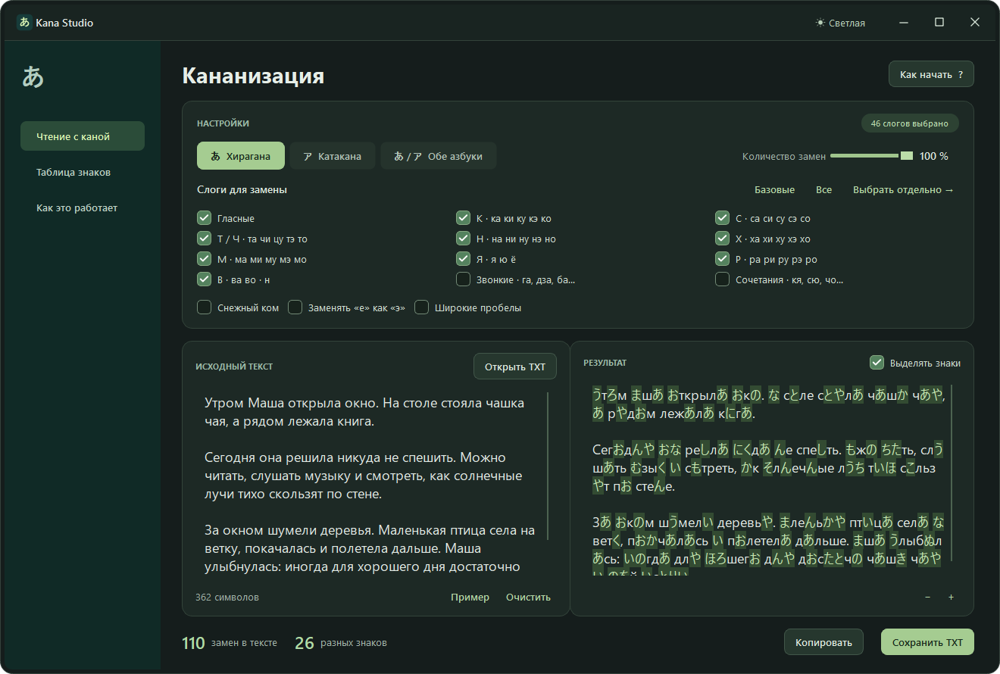
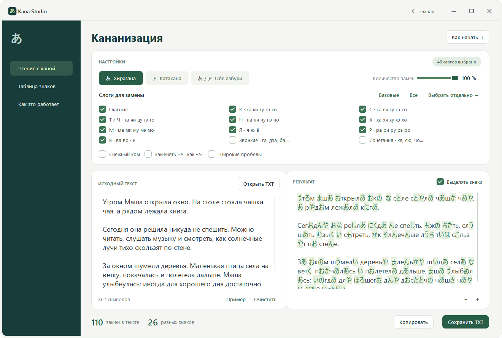

# Kana Studio

Версия для Windows — **1.1.1**. Версия для Android — **1.0.0**. [Изменения](CHANGELOG.md).

Самостоятельное Windows-приложение для изучения хираганы и катаканы через чтение русских текстов. Написано с нуля на Python и PySide6 по описанию метода «Кананизации».

## Android

[Скачать APK для Android 8.0 и новее](https://github.com/GodRayine/KanaStudio/releases/tag/android-v1.0.0). Нативное приложение с тремя вкладками, светлой и тёмной темами, выбором слогов, подсказками по нажатию, TXT и локальным черновиком.

Полностью локальная работа: в APK **нет запрашиваемых разрешений**, в том числе `INTERNET`; нет рекламных и аналитических SDK, WebView, внешних шрифтов или сервисов. Облачное резервное копирование и перенос данных отключены. [Установка, приватность и сборка](android/README.md).

## Запуск готовой программы

[Скачать последний релиз](https://github.com/GodRayine/KanaStudio/releases/latest):

- **KanaStudio.exe** — приложение одним файлом. Можно сразу запустить или скопировать в любую папку.
- **KanaStudio-win-x64.zip** — переносимая версия с инструкцией и лицензиями. Распакуй архив и открой `KanaStudio.exe`.
- **KanaStudio-v1.1.1-source.zip** — полный код, тесты, снимки интерфейса, лицензии и сценарий сборки.

Установка, Python и интернет для работы готового приложения не нужны. Windows 10/11 x64. Для обновления закрой предыдущую версию и запусти новую: настройки и черновик сохранятся.

1. Вставь текст в левое поле или нажми «Пример».
2. Выбери азбуку и группы слогов. Кнопка «Выбрать отдельно» открывает таблицу знаков.
3. Читай результат справа. Наведение на японский знак показывает чтение и исходный слог.
4. Скопируй результат или сохрани его как TXT UTF-8.

## Возможности

- Тёмная и светлая темы; переключатель в верхней панели, выбранная тема сохраняется.
- Верхняя панель с управлением окном. Перетаскивай её для перемещения, дважды щёлкни для разворачивания; края и углы меняют размер окна.

- Хирагана, катакана и воспроизводимый смешанный режим с чередованием азбук.
- 46 базовых знаков, 25 звонких/полузвонких слогов и 33 сочетания с маленькими я/ю/ё.
- Выбор групп и отдельных слогов; ち / チ соответствует «чи», сочетания ちゃ / ちゅ / ちょ — «ча / чу / чо». «Ти» не заменяется на ち. Также поддерживаются варианты си/ши, ху/фу и другие.
- Регулировка количества замен от 0 до 100 процентов.
- «Снежный ком»: частота замен постепенно растёт по ходу текста, до значения ползунка. На коротком тексте отдельные слоги могут остаться без замены.
- Опциональная замена е как э и японские полноширинные пробелы.
- Подсветка, подсказки, изменение размера текста, счётчики замен и разных слогов.
- Загрузка TXT в UTF-8, UTF-8 BOM, UTF-16 с BOM и Windows-1251. Экспорт — UTF-8.
- Локальное сохранение настроек и черновика между запусками.

Настройки и черновик хранятся в реестре текущего пользователя: `HKEY_CURRENT_USER\Software\KanaStudio\KanaStudio`. Программа не отправляет текст в сеть. Черновики свыше 200 000 символов не сохраняются автоматически; их можно сохранить кнопкой TXT. Для текстов свыше 120 000 символов подсветка и подсказки отключаются, чтобы уменьшить нагрузку. Загрузка файлов ограничена 2 МБ.

Очистку текста можно отменить через Ctrl+Z. Ctrl+O открывает файл, Ctrl+S сохраняет результат, Ctrl+Enter обновляет его, F1 открывает справку. Левое и правое поля разделены перетаскиваемой границей.

Программа выполняет приблизительную учебную замену слогов, а не перевод. Кириллический регистр исходного слога доступен в подсказке; японские знаки регистра не имеют. Сначала распознаются самые длинные выбранные слоги. Смешанный режим чередует хирагану и катакану; новый алгоритм «Снежного кома» не обещает побайтового совпадения с оригиналом.

## Разработка

Windows и Python 3.12 x64. Установка зависимостей требует интернет. Клонируй репозиторий либо распакуй архив исходников и открой PowerShell в папке с `app.py`:

```powershell
git clone https://github.com/GodRayine/KanaStudio.git
cd KanaStudio
```

```powershell
python -m venv .venv
.venv\Scripts\python.exe -m pip install -r requirements.txt
.venv\Scripts\python.exe app.py
.venv\Scripts\python.exe -m unittest -v test_kana.py test_app.py
```

Для сборки выполни `./build.ps1`. Команда проверяет исходники и запуск готового EXE в обеих темах, затем создаёт исполняемый файл, переносимый архив, архив исходников и `SHA256SUMS.txt` в `release/1.1.1/`. PyInstaller включает интерпретатор и библиотеки Qt. Подробности выпуска: [docs/RELEASING.md](docs/RELEASING.md).

## Интерфейс





Снимки сделаны с демонстрационным текстом в изолированном режиме проверки, который не затрагивает пользовательский черновик и настройки.

## Проверка

Пройдены 20 тестов: таблица знаков, обе азбуки и смешанный режим, приоритет длинных слогов, плотность замен и «Снежный ком», исправление «чи» и сочетаний «ча/чу/чо», загрузка кодировок, TXT и буфер обмена, сохранение черновика, перенос старых настроек, темы и кнопки окна. Готовый EXE проверен отдельно, без соседних файлов и установленного Python для запуска.

Изолированная проверка готовой сборки:

```powershell
.\release\1.1.1\KanaStudio.exe --smoke-test "$env:TEMP\KanaStudio-check"
```

Результат — `report.json`, демонстрационный TXT и снимки обеих тем в указанной папке. Обычные настройки приложения не меняются.

## Лицензия

Copyright (C) 2026 GodRayine. Код Kana Studio распространяется по **GNU GPL версии 3 или любой более поздней** (`GPL-3.0-or-later`), без гарантий. Полный текст — [LICENSE](LICENSE), уведомление — [COPYRIGHT](COPYRIGHT). Исходники доступны в репозитории и в архиве каждого релиза. Лицензии сторонних компонентов сохранены отдельно в [THIRD-PARTY.md](THIRD-PARTY.md) и каталоге [licenses](licenses).

## Источник идеи

Изучены [описание на japlang.ru](https://www.japlang.ru/soft/index.html), [справка](https://www.japlang.ru/soft/spravka.html) и снимок интерфейса оригинальной программы. Идея метода — Илья Виноградов; автор исходной «Кананизации» — Алексей Сергеев. Код, исполняемые файлы и тексты оригинала не включены в готовое приложение. Это независимая реализация, а не официальное обновление исходной программы.

Используемые библиотеки: PySide6 / Qt — LGPLv3, GPLv3 или коммерческие условия; PyInstaller — GPL с исключением для собранных приложений. Сведения и лицензии включены рядом с готовой сборкой.
