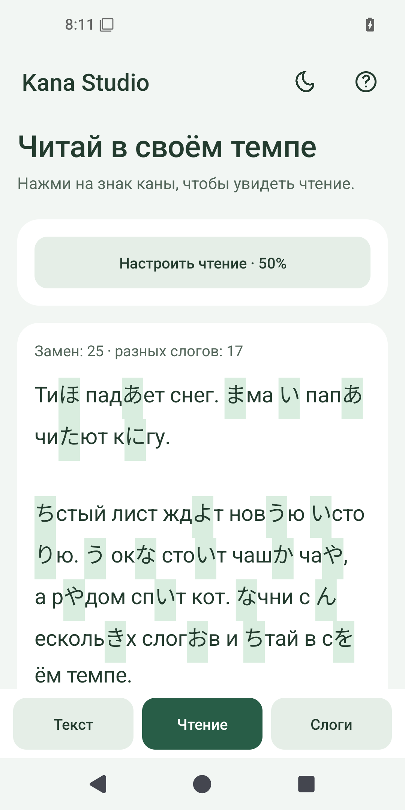
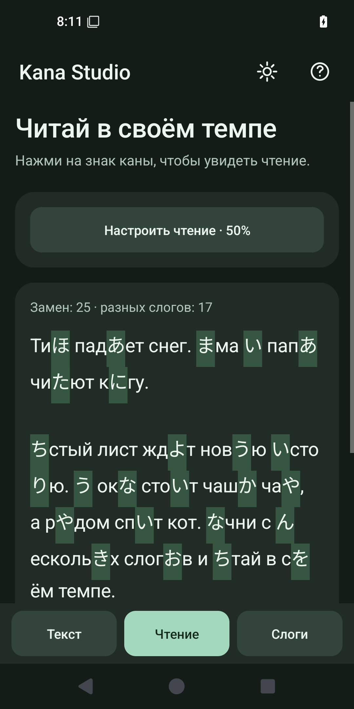
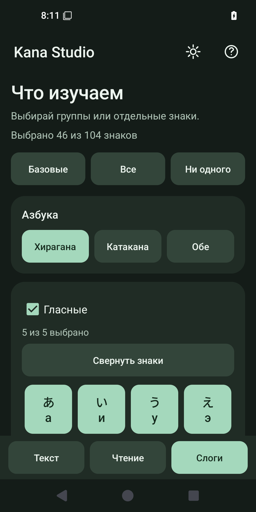

# Kana Studio для Android

Версия **1.0.0**, Android **8.0+** (API 26). Один APK подходит для ARM, ARM64 и x86: приложение использует только стандартные Android API и не содержит нативных библиотек.

## Установка

1. Скачай `KanaStudio-Android-1.0.0.apk` из [Android-релиза](https://github.com/GodRayine/KanaStudio/releases/tag/android-v1.0.0).
2. Открой APK на телефоне. Если Android попросит, разреши установку этому файловому менеджеру или браузеру.
3. После установки открой Kana Studio. Интернет и учётная запись для работы не нужны.

Обновления устанавливаются поверх существующего приложения, если подписаны тем же ключом. Android и Windows хранят свои настройки независимо; переносить тексты можно файлами TXT.

## Как пользоваться

- **Текст:** вставь русский текст, открой TXT из памяти телефона или нажми «Пример». Выбери азбуку.
- **Чтение:** читай результат; нажми на кану для подсказки либо открой список «Чтения». Кнопка «Настроить чтение» открывает плотность замен и «Снежный ком». Доступны размер текста, подсветка, копирование и сохранение TXT.
- **Слоги:** выбери базовые знаки, все знаки, группы либо отдельные знаки. Здесь же находятся е как э и широкие пробелы.

ち / チ соответствует «чи», а не «ти». ちゃ / ちゅ / ちょ — «ча / чу / чо». Это приблизительный учебный метод, а не перевод или точная транскрипция японского произношения.

TXT до 2 МБ: UTF-8, UTF-8 BOM, UTF-16 с BOM, Windows-1251. Сохранение — UTF-8. Черновики до 200 000 символов сохраняются автоматически; более длинный текст сохрани вручную как TXT. Подсветка и подсказки внутри текста отключаются после 120 000 символов, список чтений остаётся доступен.

## Локальная работа и приватность

- В исходном и скомпилированном манифесте нет `uses-permission`. Приложение не запрашивает `INTERNET`, состояние сети, доступ к контактам, камере или общему хранилищу.
- Нет WebView, HTTP-клиентов, рекламы, аналитики, обновления по сети, загрузки шрифтов или внешних SDK.
- Настройки и черновик находятся в приватном хранилище приложения. `allowBackup=false`; правила резервного копирования исключают все категории данных из облачной копии и переноса между устройствами.
- TXT выбирается через системный диалог с `EXTRA_LOCAL_ONLY=true`. Доступ предоставляется только к выбранному документу; постоянный доступ к папкам не запрашивается.
- Приложение не читает буфер обмена в фоне. Копирование выполняется только по нажатию пользователя.
- Удаление данных приложения в настройках Android удаляет черновик и настройки. Файлы TXT, сохранённые пользователем отдельно, остаются на устройстве.

Проверка разрешений описана в [документации Android](https://developer.android.com/reference/android/Manifest.permission#INTERNET), параметры резервного копирования — в [Auto Backup](https://developer.android.com/identity/data/autobackup).

## Интерфейс







## Сборка в Windows

Нужны Python 3.12, JDK 21 и официальный Android SDK: `platforms;android-36`, `build-tools;36.0.0`. Для проверки на эмуляторе также нужны `platform-tools`, `emulator`, `system-images;android-35;default;x86_64`.

Используются `javac`, AAPT2, D8, zipalign и apksigner из официальных инструментов. Gradle, Android Studio и сторонние зависимости не нужны. Загрузка инструментов требует интернет только на компьютере; после их установки сборка работает локально.

```powershell
# В корне репозитория. Подставь собственные пути к SDK и JDK.
python -B android/build.py --sdk C:/Android/sdk --jdk C:/Java/jdk-21 --initialize-signing-key
```

`--initialize-signing-key` разрешает создание нового ключа только при первой сборке. По умолчанию ключ и файл пароля находятся **вне репозитория**: `%USERPROFILE%/.codex/secrets/KanaStudio-android/`. Сохрани их приватную резервную копию: без исходного ключа APK не сможет обновить уже установленное приложение. Не публикуй этот каталог. Можно выбрать другой приватный каталог через `--signing-dir`.

Сценарий проверяет 725 случаев на совпадение с Windows-алгоритмом, собирает APK, подписывает его постоянным ключом, проверяет подпись и отсутствие разрешений. Результаты находятся в `release/android/1.0.0/`: APK, `SHA256SUMS.txt`, `verification.json`.

Таблица и эталонные тесты уже включены в исходники. После изменения `kana.py` обнови их:

```powershell
python -B android/tools/generate_table.py
```

## Проверка в эмуляторе

Внимание: сценарий UI-проверки очищает данные Kana Studio **в указанном эмуляторе**. Он отказывается работать с серийным номером физического телефона.

```powershell
python -B android/build.py --sdk C:/Android/sdk --jdk C:/Java/jdk-21 --with-device-tests
adb -s emulator-5580 install -r release/android/1.0.0/KanaStudio-Android-1.0.0.apk
adb -s emulator-5580 install -r android/build/KanaStudio-device-tests.apk
adb -s emulator-5580 shell am instrument -w com.godrayine.kanastudio.tests/com.godrayine.kanastudio.SmokeInstrumentation
python -B android/tools/qa_device.py --adb C:/Android/sdk/platform-tools/adb.exe --serial emulator-5580
```

Проверены Android 15 в эмуляторе, отсутствие разрешений и облачной копии, кодировки, замены, выбор слогов, темы, черновик, кнопки и цели касания. UI проверяется на телефоне шириной 375 dp, при шрифте 200%, в альбомной ориентации и на планшете 1024 dp. Снимки нужно просмотреть вручную. Проверка на физическом телефоне пока не проводилась.

## Лицензия

Copyright (C) 2026 GodRayine. GNU GPL v3 или более поздняя версия. Полные [LICENSE](../LICENSE) и [COPYRIGHT](../COPYRIGHT) включены в APK; текст GPL доступен в справке без сети. Версия Android не включает Python, PySide6, Qt или PyInstaller. Используются системные компоненты и шрифты Android, они не перераспределяются внутри APK.
